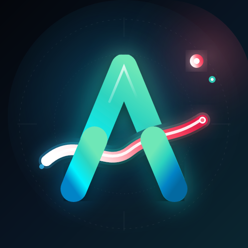

# Anyflow Lab

**Тестовая версия Anyflow: новые функции и темы раньше всех**

---

⚠️ Это лаборатория: сюда попадает всё новое сразу после изменений, поэтому что-то может работать нестабильно.
Для обычного просмотра лучше основное приложение: **[Anyflow](https://github.com/vanaedynak/AniPlayer)**.

Lab ставится отдельно от основного Anyflow, со своими настройками, и обновляется сам.

© 2026 vanaedynak. Все права защищены. Исходный код закрыт, этот репозиторий только для скачивания и обновлений.

